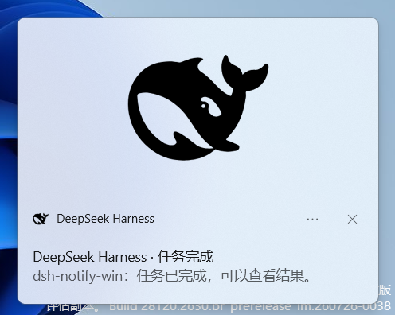
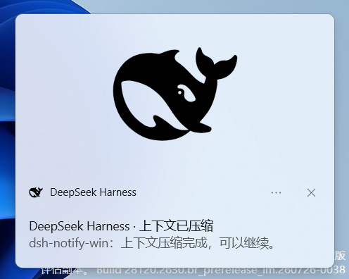
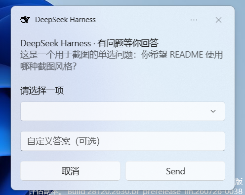
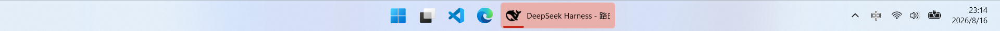

# dsh-notify-win

> DeepSeek Harness (DSH) Windows notification plugin — native toast + taskbar flash when a task finishes or your input is needed.

English | [中文](README.zh.md)


## 📸 Screenshots

### Task finished



### Context compacted



### Question — single select



### Toast timeout → taskbar flash



> Screenshots are from Windows 11. The taskbar flash is animated; the screenshot shows the DSH taskbar button highlighted by the system warm pulse.

## ✨ Features

- 🔔 **Native Windows toast** (bottom-right, Win10/11 system style)
- 💡 **Taskbar flash** (`FlashWindowEx`) when DSH is in the background
- 🖱️ **Click-to-focus** — clicking a toast opens DSH and switches to the corresponding session
- ✅ Triggers when a **task finishes** (root agent goes `idle`)
- 🧭 **Tells you WHY it stopped** — the toast reflects the `turn/end` reason instead of always claiming success: normal finish, output-token ceiling (`max-tokens`), blocked pre-step, LLM failure (provider-neutral code + retry count), or cancellation. See [Stop conditions](#stop-conditions).
- 🗜️ Triggers when **context compaction finishes** — and alerts when it **fails** (`compaction/end` with `error`)
- ❓ Triggers when **your input is needed** (approval / `ask_user_question`)
- 📋 **Question toast with pages**: a single question shows its native dropdown (up to 5 options) plus a custom-answer text box. Two or more questions become one paged toast (`问题 i/n` + 上一题 / 下一题 / 提交 / 取消); every page keeps its dropdown choice and custom text when you page back, and a `已答：…` line keeps the other answers visible.
- 🧷 **Resident helper, plugin lifetime**: one `dsh-toast-question.exe` is started when the plugin is applied and reused for every question. Disabling the plugin or quitting DSH shuts it down (stdio EOF when DSH exits), so no per-question process spawn and no orphan process.
- ✅ **An honest receipt**: after Send the toast says “已提交，等待 DSH 确认…”. It only changes to “✓ 回答已送达 agent” after the question's tool call has actually returned the answer, and then to “✓ agent 已收到并回应” with the **model's first sentence** — text that can only exist if the whole round trip really happened. Cancelling says “没有向 DSH 提交任何答案”; a card that could not be filled says “请在 DSH 窗口中手动回答”.
- 🖱️ **Answering from the toast reaches the agent**: the chosen options (and custom text, across multiple questions) are applied to the official question card and submitted, so the blocked `ask_user_question` call returns immediately
- ⏰ **Timeout flash fallback**: if an interactive toast is ignored and dismissed by the system timeout, the taskbar flashes so the pending question is not missed
- 🖼️ Badge-only toasts: no hero banner in any kind — just the app icon in the header, so notifications stay compact
- 🪪 Toasts are attributed to **DeepSeek Harness** with its own icon (registered AppUserModelID), never to “Windows PowerShell”
- 🚀 No DSH service, model approval, or settings namespace — just one resident helper child process

## 🚀 One-line install

```powershell
dsh plugin --profile web add dsh-notify-win
```

> Requires `pnpm` on PATH (`corepack enable` if missing). See [Install](#install) for details.

## Install

1. **Prerequisite: pnpm**

   ```powershell
   corepack enable
   ```

   Or without admin, put a user-level shim in a PATH directory:

   ```powershell
   Set-Content -Path "$env:LOCALAPPDATA\Microsoft\WindowsApps\pnpm.cmd" -Value "@echo off`r`ncorepack pnpm %*`r`n"
   corepack pnpm --version
   ```

2. **Install the plugin**

   ```powershell
   # From npm (recommended)
   dsh plugin --profile web add dsh-notify-win

   # Or directly from GitHub:
   dsh plugin --profile web add github:Andyqwe44/dsh-notify-win

   # If github: is blocked, use SSH:
   dsh plugin --profile web add git+ssh://git@github.com/Andyqwe44/dsh-notify-win.git
   ```

3. **Verify**

   ```powershell
   dsh --profile web --dump-config   # look for: # == dsh-notify-win / - id: dsh-notify-win
   ```

4. **Restart and test**

   ```powershell
   dsh web
   ```

   Complete any task. The first notification self-registers the branded toast identity (Start Menu shortcut + AppUserModelID, one-time). If the toast header still shows `DeepSeekHarness` without an icon, restart Explorer once:

   ```powershell
   Stop-Process -Name explorer -Force; Start-Process explorer
   ```

## Requirements

- Windows 10/11
- DeepSeek Harness, any profile (`web` recommended)
- PowerShell 7 or Windows PowerShell 5.1 (5.1 is used automatically as fallback)
- .NET 10 Desktop Runtime (x64) — only needed for **interactive question toasts** (`ask_user_question`); done/compact toasts use PowerShell and do not require it. The question helper stays resident for the plugin lifetime.

## Configuration

Edit `$env:USERPROFILE\.dsh\profiles\web\cordis.patch.yml`:

```yaml
- id: dsh-notify-win
  config:
    doneTitle: 'DeepSeek Harness · Task complete'
    doneBody: 'Your task has finished.'
    compactTitle: 'DeepSeek Harness · Context compacted'
    compactBody: 'Context compaction finished, you can continue.'
    questionTitle: 'DeepSeek Harness · Action needed'
    questionBody: 'An approval or decision is waiting.'
    askTitle: 'DeepSeek Harness · Question for you'
    askBody: 'The assistant asked you something.'
    dedupMs: 1500              # suppress duplicate notifications within this window
    questionToastDuration: 'short'  # 'short' (~5s) or 'long' (~25s) for ask_user_question toasts
    doneToastDuration: 'short'      # 'short' (~5s) or 'long' (~25s) for done/compact/approval toasts
    helperEnabled: true        # false disables the resident .NET helper (answer in DSH instead)
    helperLog: ''              # optional file for helper protocol/toast diagnostics
    answerPendingTimeoutMs: 30000  # how long "waiting for DSH" may show before it gives up
    answerSpeechTimeoutMs: 90000   # how long to wait for the model's first sentence after delivery
    helperUnavailableHint: ' (answer in the DSH window)'  # appended when the helper cannot run
    noDotNetHint: ' (install .NET 10 Desktop Runtime to answer from the toast)'  # appended when .NET is missing
    showProject: true          # prefix body with project label

    # Stop-reason notifications (defaults are Chinese; shown here in English)
    notifyOnCancel: true       # notice when the user cancels a running turn
    notifyOnError: true        # alert on max-tokens / blocked / LLM failure / failed compaction
    includeErrorCode: true     # append the machine-readable failure code to an error body
    cancelledTitle: 'DeepSeek Harness · Cancelled'
    cancelledBody: 'The task was cancelled.'
    hookCancelledBody: 'Blocked by a hook: {message}'
    maxTokensTitle: 'DeepSeek Harness · Output ceiling reached'
    maxTokensBody: 'The response hit the output limit and was truncated. Send "continue" to resume.'
    blockedTitle: 'DeepSeek Harness · Turn blocked'
    blockedBody: 'A pre-step check rejected this turn.'
    errorTitle: 'DeepSeek Harness · Task interrupted'
    errorBody: 'The task stopped abnormally: {hint}'    # {hint} = built-in code hint or provider message
    retrySuffix: ' (retried {retry}/{retryMax} times)'
    compactionFailedTitle: 'DeepSeek Harness · Compaction failed'
    compactionFailedBody: 'Context compaction failed: {message}'
```

Templates support `{message}`, `{code}`, `{hint}`, `{reason}`, `{retry}`, `{retryMax}`.

To disable:

```yaml
- id: dsh-notify-win
  disabled: true
```

Restart after install/disable changes (web profile HMR is disabled by default).

## Stop conditions

`agent/status` only says `idle`; it does not say why. The plugin therefore caches the
`turn/end` reason (which is always appended immediately before the idle transition)
and turns it into the notification:

| `turn/end` reason | Notification | Notes |
| --- | --- | --- |
| `completed` | done | normal finish |
| `max-tokens` | alert | output-token ceiling; the turn was truncated |
| `blocked` | alert | a pre-step hook/plugin rejected the turn |
| `error` | alert | LLM failure; body carries the code hint + retry count |
| `aborted` (`user`, `parent`, `legacy`) | notice | lightweight "cancelled" |
| `aborted` (`hook`) | notice | body names the hook reason |
| `aborted` (`disposed`) | **silent** | disposal cancels the driver right before teardown |
| `interrupted`, `forked` | **silent** | durable history markers (resume / fork seeds), never live stops |
| unknown (future reason) | alert | rendered from `unknownStopBody` (default text is Chinese) |

A failed context compaction (`compaction/end` with `error`) raises its own alert; a
successful one still shows the "context compacted" toast.

`error` notification details come from the provider-neutral `LlmFailure.code`
(`RATE_LIMIT`, `SERVER`, `TIMEOUT`, `TRANSPORT`, `EMPTY_RESPONSE`,
`CONTEXT_WINDOW_EXCEEDED`, `QUOTA`, `AUTH`, `MISSING_CREDENTIAL`,
`INVALID_CREDENTIAL`, `ACCOUNT_TOKEN_INVALID`, `STREAM_CLOSED`, `NO_ADAPTER`,
`UNKNOWN_MODEL`, `INVALID_CONFIG`, `UNSUPPORTED_OPTION`, `ABORTED`, `UNKNOWN`, …).
Unlisted codes fall back to the provider message. Retry counts come from the
durable `llm/retry` events — the framework has no distinct "retries exhausted"
reason, so the plugin reports the retry count from the last retry record
(`retrySuffix`, default Chinese).

## How it works

| Concern | Implementation |
| --- | --- |
| Trigger "done"/alert/notice | `session/event` → `turn/end` reason cache + `agent/status` `idle` (root agents only) |
| Trigger "compact" / compaction failure | `session/event` → `compaction/end` |
| Trigger "question" | `approval/request` waterfall + `tools/execute` for `ask_user_question` |
| Done/compact/alert/notice toast | WinRT `Windows.UI.Notifications` via `notify.ps1` (entry) + `notify/_common.ps1` (OS plumbing) + `notify/_kinds.ps1` (per-kind presentation), falls back to `NotifyIcon` balloon |
| Interactive question toast | Resident .NET helper `dsh-toast-question.exe --serve`, spoken to over the child's stdin/stdout (newline-delimited JSON). One question = one card; several questions = one paged card (`问题 i/n`, 上一题/下一题/提交), with each page's draft restored through the toast `defaultInput` attribute |
| Question answer receipt | The helper reports the selection; the host parks it for the browser half and only sends “delivered” after the `ask_user_question` tool result returns, then “spoken” with the first `text-delta` of the model's reply |
| Helper lifetime | Plugin `apply` starts it → `ctx.effect` disposal sends `shutdown`; DSH exit closes stdin (EOF) and the helper exits; a crashed host leaves no orphan |
| Taskbar flash | `EnumWindows` + `FlashWindowEx` (`FLASHW_TRAY \| FLASHW_TIMERNOFG` = 14) |
| Execution | Done/compact/alert/notice via fire-and-forget PowerShell; questions via the resident helper |

The plugin registers no service, tool, or settings namespace — a plain consumer row, safe in any profile.

### Helper lifecycle

| Event | What happens |
| --- | --- |
| Plugin applied (DSH start, reload) | The host probes `--check` once, then spawns `dsh-toast-question.exe --serve` and waits for its `ready` line (5 s). |
| Question asked | One JSON `question` line on the helper's stdin — no new process. |
| User answers | The helper emits `answer`; the host parks it for the browser half and keeps the toast at “等待 DSH 确认”. |
| Tool result returns | The host compares the returned answers with the toast's, sends `delivered`, then `spoken` with the model's first sentence. |
| Plugin disabled / profile row removed | `ctx.effect` disposal sends `shutdown`; the helper exits within 1.5 s (force-terminated otherwise). |
| DSH quits or crashes | The helper's stdin reaches EOF and it exits on its own; the managed subprocess range is also reaped by DSH. |

## Known limitations

- Native toast text is compact: only about 4 lines are displayed, so long content is truncated.
- The native selection dropdown may collapse when the pointer moves onto the popup; if the toast is then dismissed by timeout, the taskbar flash still reminds you.
- `FlashWindowEx` uses the system's warm-pulse highlight; custom colors are not possible.
- Windows never flashes the foreground window — the taskbar button only flashes when DSH is in the background.
- A cancelled turn is reported as "cancelled" (not "task complete"); set `notifyOnCancel: false` to silence it, or `notifyOnError: false` to silence abnormal-stop alerts.
- Notifications are deduplicated per session within `dedupMs` (default 1500 ms). A second `idle` for an already-reported turn stays quiet.
- Interactive question toasts require the .NET 10 Desktop Runtime on the machine. If it is missing, the plugin falls back to a plain PowerShell toast that still surfaces the question and appends a hint to install .NET.
- Multi-question toasts page by re-showing the native toast. Windows animates the old toast out and the new one in, so each page change has a short visual gap; the `已答` line carries the context across it. Multi-question cards always use the long duration (about 25 s).
- A custom answer wins over the dropdown selection on the same page, exactly like the previous single-question toast; clear the text box if you only want the dropdown choice.
- The receipt cannot be faked by the UI: “delivered” is the actual `ask_user_question` tool result and “spoken” is the model's own first sentence. If the model produces no visible text (for example it immediately calls another tool), the toast says “本轮没有文本回复”.
- If the DSH window is closed, the browser half cannot fill the official card; an honest “未收到 DSH 确认” follows after `answerPendingTimeoutMs` and you can still answer in DSH.
- Windows does not allow an unpackaged desktop identity to delete its own toasts from Action Center. A toast whose question has already been settled can stay listed until it expires; clicking it does nothing.

## Development

```powershell
npm run check     # syntax check
npm test          # smoke + proof-pipeline + helper protocol/lifecycle tests

# Show a real toast + taskbar flash (Windows PowerShell 5.1: the WinRT toast
# projection is unavailable in PowerShell 7, which silently degrades to a balloon):
powershell -NoProfile -File lib/notify.ps1 -Kind done -Title "test" -Body "test"

# Reproduce an abnormal-stop alert:
powershell -NoProfile -File lib/notify.ps1 -Kind alert -Title "test" -Body "retry exhausted" `
  -Reason error -Code RATE_LIMIT -Retry 5 -RetryMax 5 -Duration long

# Rebuild the resident question helper. The exe is locked while a helper is
# running, so quit DSH (or stop dsh-toast-question.exe) first.
dotnet publish src/DshToastQuestion/DshToastQuestion.csproj -c Release -r win-x64 --self-contained false -p:PublishSingleFile=true -o lib
```

`npm test` runs three suites: `test/smoke.mjs` (notification logic with a mocked ctx),
`test/proof.mjs` (question → parked answer → tool result → first sentence, using a fake
helper that speaks the real protocol), and `test/helper-protocol.mjs` (the real exe:
`--check`, `ready`, `ping`, `shutdown`, and exit on stdin EOF).

## Project layout

```
dsh-notify-win/
├── lib/
│   ├── index.js               # Host half: events, stop reason, helper lifecycle, answer proofs
│   ├── client.js              # Browser-side click-to-focus + official-card driver
│   ├── notify.ps1             # Entry: validate kind, run the toast pipeline
│   ├── notify/
│   │   ├── _common.ps1        # Identity, protocol, theme, toast/balloon, taskbar flash
│   │   └── _kinds.ps1         # Per-kind presentation (done/compact/alert/notice/question)
│   ├── focus-dsh.ps1          # Focus/launch the DSH Edge PWA
│   ├── focus-dsh.vbs          # Hidden launcher for focus-dsh.ps1
│   ├── dsh-toast-question.exe # Resident question helper (C#, --serve)
│   └── dsh-*.png / dsh-*.ico  # Branding assets
├── src/DshToastQuestion/
│   ├── Program.cs             # C# helper source (stdio JSON protocol)
│   └── DshToastQuestion.csproj
├── test/
│   ├── smoke.mjs              # Notification logic smoke test
│   ├── proof.mjs              # Answer → tool result → first-sentence receipt
│   ├── helper-protocol.mjs    # Real exe protocol/lifecycle test
│   └── headless-overlay.yml
├── docs/
│   └── assets/screenshots/    # README screenshots
├── cordis.patch.yml           # DSH bundle patch
├── package.json               # dsh.bundle declaration
├── README.md
└── README.zh.md
```

## Links

- 🌐 Landing page: https://Andyqwe44.github.io/dsh-notify-win/

## Roadmap

- **V1 (implemented)**: done + compact + question toasts; single-select dropdown with custom answer; Cancel / Send; timeout → taskbar flash fallback.
- **V1.1 (implemented)**: paged multi-question toast with per-page drafts (dropdown + custom text); multi-select question toast by numbered input; multi-question card driving; honest two-stage receipt backed by the tool result and the model's first sentence.
- **V2 (planned)**: fully self-contained packaging (no .NET runtime install) and/or background activation so toast buttons submit without any foreground activation.

## License

[MIT](LICENSE)
