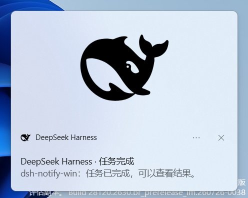
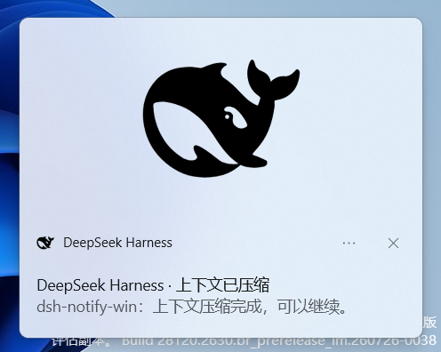
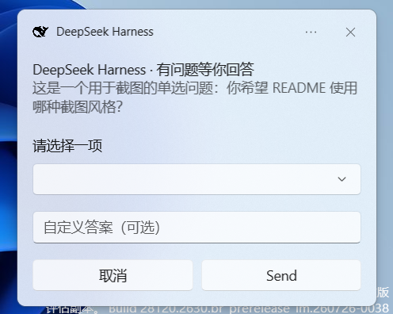
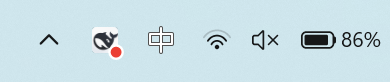
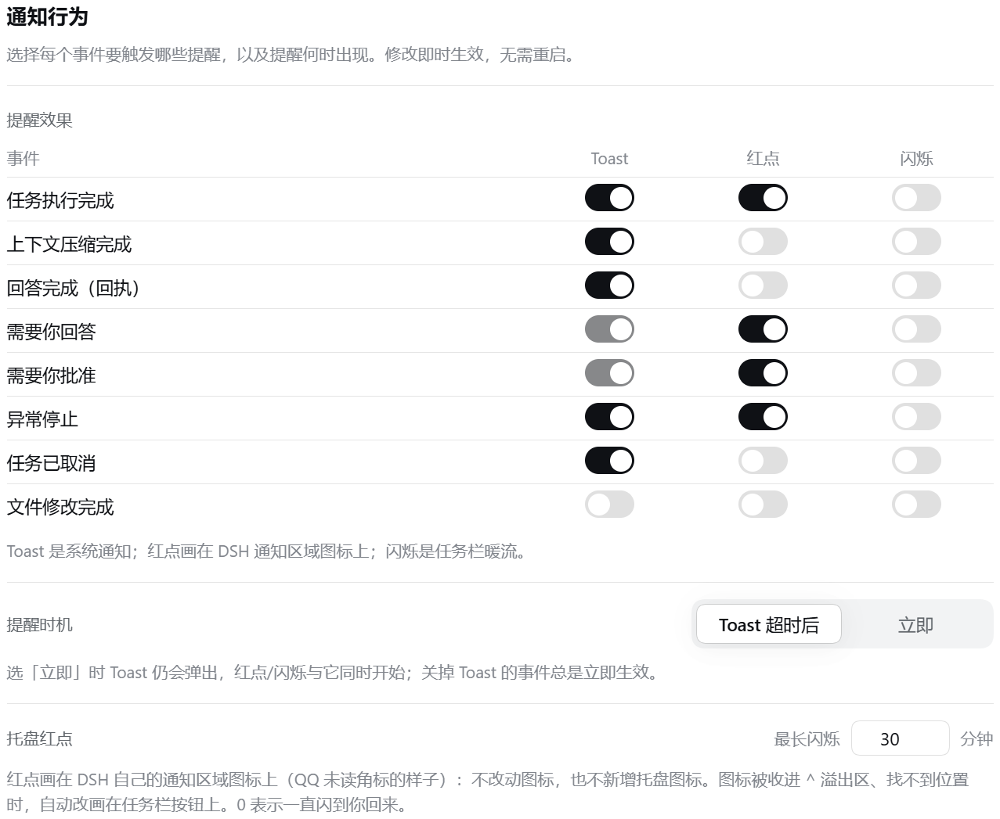
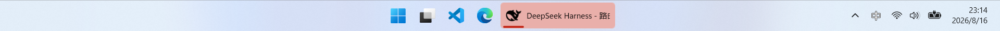

# dsh-notify-win

> DeepSeek Harness (DSH) Windows notification plugin — native toast, a QQ-style unread badge on DSH's own tray icon, and an optional taskbar flash when a task finishes or your input is needed. Every event chooses its own reminders on the plugin page (插件 → dsh-notify-win).

English | [中文](README.zh.md)


## 📸 Screenshots

### Task finished



### Context compacted



### Question — single select



### Ignored toast → QQ-style unread badge on DSH's own tray icon



### All settings live on the plugin's own page (插件 → dsh-notify-win)



### Optional: warm taskbar flash instead of the badge



> Screenshots are from Windows 11. The default reminder after an ignored toast is the red unread badge on DSH's own notification-area icon (QQ style); the warm taskbar pulse is opt-in per event, and the notification matrix, its timing and the badge limit are all edited on the plugin's page — nothing is added to Settings.

## ✨ Features

- 🔔 **Native Windows toast** (bottom-right, Win10/11 system style)
- 🔴 **QQ-style tray badge** — when a toast is ignored, a red unread dot blinks on DSH's own notification-area icon; the icon itself is untouched and no tray icon is added. It stops on a DSH foreground window, when the question is answered, or when the configured limit expires; if the icon is filed under the `^` overflow the dot moves to the taskbar button
- 💡 **Optional taskbar flash** (`FlashWindowEx`) — off by default, can be enabled per event; the OS stops it as soon as DSH comes to the foreground
- 🖱️ **Click-to-focus** — clicking a toast opens DSH and switches to the corresponding session
- ✅ Triggers when a **task finishes** (root agent goes `idle`)
- 🧭 **Tells you WHY it stopped** — the toast reflects the `turn/end` reason instead of always claiming success: normal finish, output-token ceiling (`max-tokens`), blocked pre-step, LLM failure (provider-neutral code + retry count), or cancellation. See [Stop conditions](#stop-conditions).
- 🗜️ Triggers when **context compaction finishes** — and alerts when it **fails** (`compaction/end` with `error`)
- ❓ Triggers when **your input is needed** (approval / `ask_user_question`)
- 📋 **Question toast with pages**: a single question shows its native dropdown (up to 5 options) plus a custom-answer text box. Two or more questions become one paged toast (`问题 i/n` + 上一题 / 下一题 / 提交 / 取消); every page keeps its dropdown choice and custom text when you page back, and a `已答：…` line keeps the other answers visible.
- 🧷 **Resident helper, plugin lifetime**: one `dsh-toast-question.exe` is started when the plugin is applied and reused for every question. Disabling the plugin or quitting DSH shuts it down (stdio EOF when DSH exits), so no per-question process spawn and no orphan process.
- ✅ **One honest receipt**: submitting closes the question toast; nothing else pops up until the model answers, and then exactly one toast appears — the **model's first line**, filled to the toast width and cut with `…` when it is longer (no “已提交” / “已送达” / “已收到并回应” stages, no title line). Text that can only exist if the whole round trip really happened. If the model produces no visible text, nothing is shown (no invented receipt). Cancelling says “没有向 DSH 提交任何答案”; a card that could not be filled says “请在 DSH 窗口中手动回答”.
- 🖱️ **Answering from the toast reaches the agent**: the chosen options (and custom text, across multiple questions) are applied to the official question card and submitted, so the blocked `ask_user_question` call returns immediately
- ⏰ **Per-event reminders**: every event (task done, compaction, reply receipt, question, approval, error, cancel, file change) independently chooses toast / tray badge / taskbar flash, and whether the attention effects start right away or only after the toast times out. Configure it on **插件 → dsh-notify-win**; changes apply without a restart.
- 🖼️ Badge-only toasts: no hero banner in any kind — just the app icon in the header, so notifications stay compact
- 🪪 Toasts are attributed to **DeepSeek Harness** with its own icon (registered AppUserModelID); the generic PowerShell toast identity is used only as a last resort if the branded notifier cannot be created
- 🚀 One resident helper child process; the host half registers no DSH service and no tool (its Config schema only drives the settings page)

## 🚀 One-line install

```powershell
dsh plugin --profile web add github:Andyqwe44/dsh-notify-win
```

> Requires `pnpm` on PATH (`corepack enable` if missing). See [Install](#install) for details.
>
> The npm package still sits at `0.1.1` (the old PowerShell implementation); `0.8.1` is not published yet because the account's 2FA device is lost. Install from GitHub — the repository is the current version.

## Install

1. **Prerequisite: pnpm**

   ```powershell
   corepack enable
   ```

   Or without admin, put a user-level shim in a PATH directory:

   ```powershell
   Set-Content -Path "$env:LOCALAPPDATA\Microsoft\WindowsApps\pnpm.cmd" -Value "@echo off`r`ncorepack pnpm %*`r`n"
   corepack pnpm --version
   ```

2. **Install the plugin**

   ```powershell
   # From GitHub (recommended while the npm release is behind)
   dsh plugin --profile web add github:Andyqwe44/dsh-notify-win

   # If github: is blocked, use SSH:
   dsh plugin --profile web add git+ssh://git@github.com/Andyqwe44/dsh-notify-win.git

   # The desktop app accepts the same address in Plugins -> Add plugin:
   #   github:Andyqwe44/dsh-notify-win
   ```

3. **Verify**

   ```powershell
   dsh --profile web --dump-config   # look for: # == dsh-notify-win / - id: dsh-notify-win
   ```

4. **Restart and test**

   ```powershell
   dsh web
   ```

   Complete any task. The first notification self-registers the branded toast identity (Start Menu shortcut + AppUserModelID, one-time). If the toast header still shows `DeepSeekHarness` without an icon, restart Explorer once:

   ```powershell
   Stop-Process -Name explorer -Force; Start-Process explorer
   ```

## Requirements

- Windows 10/11 (x64)
- DeepSeek Harness, any profile (`web` recommended)
- .NET 10 Desktop Runtime (x64) — **required**: the resident toast helper is the only notification implementation. All toasts (done / compact / alert / notice, interactive approval and questions) go through it. Install with `winget install Microsoft.DotNet.DesktopRuntime.10` or from <https://dotnet.microsoft.com/download/dotnet/10.0>. No PowerShell script is used.

## Configuration

Edit `$env:USERPROFILE\.dsh\profiles\web\cordis.patch.yml`:

```yaml
- id: dsh-notify-win
  config:
    doneTitle: 'DeepSeek Harness · Task complete'
    doneBody: 'Your task has finished.'
    compactTitle: 'DeepSeek Harness · Context compacted'
    compactBody: 'Context compaction finished, you can continue.'
    questionTitle: 'DeepSeek Harness · Action needed'
    questionBody: 'An approval or decision is waiting.'
    askTitle: 'DeepSeek Harness · Question for you'
    askBody: 'The assistant asked you something.'
    dedupMs: 1500              # suppress duplicate notifications within this window
    questionToastDuration: 'short'  # 'short' (~5s) or 'long' (~25s) for ask_user_question toasts
    doneToastDuration: 'short'      # 'short' (~5s) or 'long' (~25s) for done/compact/alert/notice toasts
    approvalToastDuration: 'long'   # 'short' or 'long' for interactive approval requests
    helperLog: ''              # optional file for helper protocol/toast diagnostics
    answerPendingTimeoutMs: 30000  # how long a parked answer waits for the browser half before warning
    answerSpeechTimeoutMs: 90000   # how long to wait for the model's first line after delivery
    showProject: true          # prefix body with project label

    # Notification behavior. The plugin page (插件 → dsh-notify-win) edits these live.
    eventPolicy:
      done:      { toast: true, blink: true,  flash: false }
      compact:   { toast: true, blink: false, flash: false }
      receipt:   { toast: true, blink: false, flash: false }
      question:  { toast: true, blink: true,  flash: false }   # toast is always on
      approval:  { toast: true, blink: true,  flash: false }   # toast is always on
      error:     { toast: true, blink: true,  flash: false }
      cancelled: { toast: true, blink: false, flash: false }
      file:      { toast: false, blink: false, flash: false }
    attention:
      timing: 'after-timeout'   # 'after-timeout' (when an ignored toast expires) or 'immediate'
      blinkMaxMinutes: 30       # 0 = blink until you come back
      blinkIntervalMs: 600
    fileChangeTitle: 'DeepSeek Harness · File changed'
    fileChangeBody: 'Updated {path}'

    # Stop-reason notifications (defaults are Chinese; shown here in English)
    notifyOnCancel: true       # notice when the user cancels a running turn
    notifyOnError: true        # alert on max-tokens / blocked / LLM failure / failed compaction
    includeErrorCode: true     # append the machine-readable failure code to an error body
    cancelledTitle: 'DeepSeek Harness · Cancelled'
    cancelledBody: 'The task was cancelled.'
    hookCancelledBody: 'Blocked by a hook: {message}'
    maxTokensTitle: 'DeepSeek Harness · Output ceiling reached'
    maxTokensBody: 'The response hit the output limit and was truncated. Send "continue" to resume.'
    blockedTitle: 'DeepSeek Harness · Turn blocked'
    blockedBody: 'A pre-step check rejected this turn.'
    errorTitle: 'DeepSeek Harness · Task interrupted'
    errorBody: 'The task stopped abnormally: {hint}'    # {hint} = built-in code hint or provider message
    retrySuffix: ' (retried {retry}/{retryMax} times)'
    compactionFailedTitle: 'DeepSeek Harness · Compaction failed'
    compactionFailedBody: 'Context compaction failed: {message}'
```

Templates support `{message}`, `{code}`, `{hint}`, `{reason}`, `{retry}`, `{retryMax}`.

### Notification behavior (Plugins → dsh-notify-win)

The same matrix is available as switches in DSH: **插件 → dsh-notify-win**, i.e. a
settings section on the plugin's own detail page (the client half registers it into
`plugins.bundle.config`). Each row is one event; the three columns are the toast, the
tray badge and the taskbar flash, and the same page carries the reminder timing and the
badge's blink limit. `eventPolicy` and `attention` are declared `.volatile()`, so a
switch writes through DSH's settings transport and the running plugin picks the new
value up on the next event — no restart.

The section lives on the plugin's page rather than in **Settings** so the global
settings list stays short: one entry per installed plugin turns that list into noise.

The tray badge note: DSH's tray icon belongs to the Electron main process; replacing its bitmap from another process is undocumented and can leave a broken icon behind, so nothing is replaced. The helper instead places a click-through layered window (`WS_EX_LAYERED | WS_EX_TRANSPARENT | WS_EX_NOACTIVATE`) over the icon's cell and paints the dot there. The cell comes from the documented `Shell_NotifyIconGetRect` (Electron hosts its icon on `Electron_NotifyIconHostWindow`), and because the window belongs to the helper it disappears with it. When Windows 11 files the icon under the `^` overflow the rectangle is unavailable, so the dot falls back to a taskbar-button overlay (`ITaskbarList3::SetOverlayIcon`).

The reminder is event-driven, with no polling thread: while idle the badge thread blocks in its message loop (measured 0.0 ms CPU over 10 s), and while blinking each frame is one `WM_TIMER` plus one `Shell_NotifyIconGetRect` (the window/id pair is cached, so the steady state is a single shell call). Taskbar moves and DPI/theme changes arrive as `WM_DISPLAYCHANGE` / `WM_SETTINGCHANGE` on the overlay window, and returning to DSH is caught by the existing foreground hook. The per-frame position read stays because Windows emits no event when an icon is filed into the `^` overflow or the tray re-lays out — the shell query is the only documented way to notice.

To disable:

```yaml
- id: dsh-notify-win
  disabled: true
```

Restart after install/disable changes (web profile HMR is disabled by default).

## Stop conditions

`agent/status` only says `idle`; it does not say why. The plugin therefore caches the
`turn/end` reason (which is always appended immediately before the idle transition)
and turns it into the notification:

| `turn/end` reason | Notification | Notes |
| --- | --- | --- |
| `completed` | done | normal finish |
| `max-tokens` | alert | output-token ceiling; the turn was truncated |
| `blocked` | alert | a pre-step hook/plugin rejected the turn |
| `error` | alert | LLM failure; body carries the code hint + retry count |
| `aborted` (`user`, `parent`, `legacy`) | notice | lightweight "cancelled" |
| `aborted` (`hook`) | notice | body names the hook reason |
| `aborted` (`disposed`) | **silent** | disposal cancels the driver right before teardown |
| `interrupted`, `forked` | **silent** | durable history markers (resume / fork seeds), never live stops |
| unknown (future reason) | alert | rendered from `unknownStopBody` (default text is Chinese) |

A failed context compaction (`compaction/end` with `error`) raises its own alert; a
successful one still shows the "context compacted" toast.

`error` notification details come from the provider-neutral `LlmFailure.code`
(`RATE_LIMIT`, `SERVER`, `TIMEOUT`, `TRANSPORT`, `EMPTY_RESPONSE`,
`CONTEXT_WINDOW_EXCEEDED`, `QUOTA`, `AUTH`, `MISSING_CREDENTIAL`,
`INVALID_CREDENTIAL`, `ACCOUNT_TOKEN_INVALID`, `STREAM_CLOSED`, `NO_ADAPTER`,
`UNKNOWN_MODEL`, `INVALID_CONFIG`, `UNSUPPORTED_OPTION`, `ABORTED`, `UNKNOWN`, …).
Unlisted codes fall back to the provider message. Retry counts come from the
durable `llm/retry` events — the framework has no distinct "retries exhausted"
reason, so the plugin reports the retry count from the last retry record
(`retrySuffix`, default Chinese).

## How it works

| Concern | Implementation |
| --- | --- |
| Trigger "done"/alert/notice | `session/event` → `turn/end` reason cache + `agent/status` `idle` (root agents only) |
| Trigger "compact" / compaction failure | `session/event` → `compaction/end` |
| Trigger "question" | `approval/request` waterfall (toast + DSH panel) + `tools/execute` for `ask_user_question` |
| Trigger "file changed" | `tools/execute` for `write` / `edit` / `apply_patch` / `str_replace_editor` returning a successful result (root agents only) |
| Done/compact/alert/notice toast | Resident .NET helper `notify` op; WinRT `Windows.UI.Notifications`; a refused toast falls back to the attention effects (no tray icon). No per-notification process |
| Effect policy | `lib/config.js` resolves one `{toast, blink, flash, timing}` row per event; the host sends it with `notify`/`question` and the helper applies it on show (`immediate`) or on the toast's timed-out dismissal (`after-timeout`) |
| Tray badge | The helper places a click-through layered window over DSH's tray icon (located with `Shell_NotifyIconGetRect`) and blinks a red dot on it; it clears on a DSH foreground window, an answer/resolve, or the configured limit, and never registers a tray icon or touches the icon bitmap |
| Badge fallback | When the tray icon cannot be located (filed under `^`), the dot is drawn as an `ITaskbarList3` overlay on the taskbar button |
| Interactive approval toast | DSH's own approval panel still shows; the toast is a remote control using the same `question` op: one fixed-choice card (`允许一次` / `拒绝`, no free-text input). Its answer is parked for the browser half, which switches to the owning session and clicks the panel; the panel remains the authority. Cancelling the toast leaves the decision to the panel, and an aborted turn retires the toast |
| Interactive question toast | Resident .NET helper `question` op, spoken to over the child's stdin/stdout (newline-delimited JSON). One question = one card; several questions = one paged card (`问题 i/n`, 上一题/下一题/提交), with each page's draft restored through the toast `defaultInput` attribute |
| Question answer receipt | The helper reports the selection and dismisses the question toast; the host parks it for the browser half, checks the `ask_user_question` tool result, then shows exactly one toast — `spoken` with the model's first line (filled to the toast width, cut with `…`). No pending, delivered or title toast |
| Toast identity / protocol / focus | Helper startup registers the branded AUMID, Start Menu shortcut and `dsh-notify://` handler; clicking a toast focuses DSH in-process (or via `--focus` on the cold path) |
| Helper lifetime | Plugin `apply` starts it → `ctx.effect` disposal sends `shutdown`; DSH exit closes stdin (EOF) and the helper exits; a crashed host leaves no orphan |
| Taskbar flash | `EnumWindows` + `FlashWindowEx` (`FLASHW_TRAY \| FLASHW_TIMERNOFG` = `2 \| 12` = 14); the OS stops it when DSH is foreground, with no periodic re-pulse |
| Execution | Every notification, question and toast click goes through the resident .NET helper; there is no PowerShell path |

The host half registers no DSH service and no tool; it exports a `Config` schema (the settings page form) and consumes lifecycle events. The settings section itself is registered by the client half into the plugin page (`plugins.bundle.config`).

### Helper lifecycle

| Event | What happens |
| --- | --- |
| Plugin applied (DSH start, reload) | The host probes `--check` once, then spawns `dsh-toast-question.exe --serve` and waits for its `ready` line (5 s). The helper registers the toast identity and protocol on the way up. |
| Non-interactive notification | One JSON `notify` line on the helper's stdin — no new process. The helper shows the toast and watches `Dismissed`/`Activated`. |
| Question asked | One JSON `question` line on the helper's stdin — no new process. |
| User answers | The helper emits `answer` and removes the question toast; the host parks it for the browser half. |
| Tool result returns | The host compares the returned answers with the toast's (a mismatch is reported), then waits for the model's first line and shows it as the only receipt, cut to the toast width. |
| Question answered in the DSH card | The host sends `resolved`; the helper stops the flash and removes the question toast. |
| Plugin disabled / profile row removed | `ctx.effect` disposal sends `shutdown`; the helper exits within 1.5 s (force-terminated otherwise). |
| DSH quits or crashes | The helper's stdin reaches EOF and it exits on its own; the managed subprocess range is also reaped by DSH. |

## Known limitations

- Native toast text is compact: only about 4 lines are displayed, so long content is truncated.
- The native selection dropdown may collapse when the pointer moves onto the popup; if the toast is then dismissed by timeout, the configured reminder (tray badge by default) still tells you, and it stops once DSH is foreground.
- The .NET 10 Desktop Runtime is a hard requirement. Without it the helper cannot start and no notification can be shown; the host logs an explicit error. There is no PowerShell fallback.
- The helper is a single long-lived process. If it crashes, the next notification asks the host to spawn it again; until then, notifications are dropped with a log line.
- `FlashWindowEx` uses the system's warm-pulse highlight; custom colors are not possible.
- Windows never flashes the foreground window — the taskbar button only flashes when DSH is in the background; an active flash is stopped by the OS when the window comes to the foreground. The tray badge is independent: it also stops when a DSH window is activated.
- The tray badge is a topmost click-through window over the icon. When Windows 11 files the icon under the `^` overflow the cell cannot be read: the reminder starts on the taskbar button instead, and an icon moved there mid-blink is retargeted within about a second; `attention.blinkMaxMinutes` decides how long it stays (0 = until you come back).
- A cancelled turn is reported as "cancelled" (not "task complete"); set `notifyOnCancel: false` to silence it, or `notifyOnError: false` to silence abnormal-stop alerts.
- Notifications are deduplicated per session within `dedupMs` (default 1500 ms). A second `idle` for an already-reported turn stays quiet.
- Multi-question toasts page by re-showing the native toast. Windows animates the old toast out and the new one in, so each page change has a short visual gap; the `已答` line carries the context across it. Multi-question cards always use the long duration (about 25 s).
- A custom answer wins over the dropdown selection on the same page, exactly like the previous single-question toast; clear the text box if you only want the dropdown choice.
- The receipt cannot be faked by the UI: “spoken” is the model's own first line (cut with … to fit one toast line) and is the only toast shown after submitting. If the model produces no visible text (for example it immediately calls another tool), no receipt toast appears at all.
- If the DSH window is closed, the browser half cannot fill the official card; an honest “未收到 DSH 确认” follows after `answerPendingTimeoutMs` and you can still answer in DSH.
- Windows does not allow an unpackaged desktop identity to delete its own toasts from Action Center. A toast whose question has already been settled can stay listed until it expires; clicking it does nothing.

## Development

```powershell
npm run build     # publish the helper to artifacts/ and stage it into lib/
npm run check     # syntax check
npm test          # policy + attention guard + smoke + proof-pipeline + helper protocol tests
```

`npm run build` requires the **.NET 10 SDK** (the runtime is enough to run the
published exe). It publishes into `artifacts/publish/` and copies only the final
`dsh-toast-question.exe` into `lib/`, which is the directory npm ships. The
helper is locked while a helper is running, so quit DSH (or stop
`dsh-toast-question.exe`) before rebuilding. If `dotnet` is not on PATH, set
`DOTNET` to the full path of the SDK's `dotnet.exe`.

`npm test` runs five suites: `test/policy.mjs` (Config schema ↔ defaults,
per-event effect resolution, settings-page event keys), `test/flash-policy.mjs`
(the attention policy guard and the absence of the old scripts),
`test/smoke.mjs` (notification logic with a fake helper), `test/proof.mjs`
(question → parked answer → tool result → first line, using a fake helper that
speaks the real protocol), and `test/helper-protocol.mjs` (the real exe:
`--check`, `ready`, `ping`, `config`/`attention`, `shutdown`, and exit on stdin
EOF).

## Project layout

```
dsh-notify-win/
├── Directory.Build.props        # all generated output goes to artifacts/
├── artifacts/                   # build output (gitignored)
│   ├── bin/                     # compiled assemblies
│   └── publish/                 # single-file helper before staging
├── scripts/
│   └── build-helper.mjs         # dotnet publish + stage exe into lib/
├── src/DshToastQuestion/        # C# source only (no bin/obj)
│   ├── DshToastQuestion.csproj
│   ├── Program.cs               # entry point, CLI modes, stdin dispatch
│   ├── State.cs                 # shared state, constants, JSON options
│   ├── GlobalUsings.cs          # project-wide usings
│   ├── Protocol/
│   │   ├── WireModels.cs        # JSON messages and question models
│   │   └── HelperOutput.cs      # stdout protocol + XML escaping
│   ├── Notifications/
│   │   └── Notifications.cs     # notify op, toast delivery, tracking
│   ├── Questions/
│   │   ├── QuestionFlow.cs      # flow state, start/finish
│   │   ├── QuestionRendering.cs # toast XML, paging, drafts
│   │   ├── QuestionInteraction.cs # activated actions, submit, answers
│   │   └── QuestionStatus.cs    # host status -> receipt toasts
│   ├── Platform/
│   │   ├── ToastIdentity.cs     # AUMID, Start Menu shortcut, protocol
│   │   ├── DshWindow.cs         # find/focus/launch DSH
│   │   ├── Attention.cs         # one StartAttention/StopAttention entry point
│   │   ├── TrayBadge.cs         # QQ-style tray dot: click-through overlay, placement, timer
│   │   ├── TaskbarBadge.cs      # fallback: taskbar-button overlay (ITaskbarList3)
│   │   └── TaskbarFlash.cs      # FLASHW_TIMERNOFG / FLASHW_STOP
│   ├── Interop/
│   │   ├── TaskbarList3.cs      # ITaskbarList3 overlay-icon interface
│   │   └── NativeMethods.cs     # P/Invoke, structs
│   └── Logging/
│       └── HelperLog.cs         # optional --log file
├── lib/                         # npm package: JS, assets, staged exe
│   ├── config.js                # DEFAULTS, Config schema, effect policy
│   ├── index.js                 # host half: events, helper lifecycle, proofs
│   ├── client.js                # browser half: click-to-focus, card driver, settings page
│   ├── dsh-toast-question.exe   # staged by npm run build (gitignored)
│   └── dsh-*.png / dsh-*.ico    # branding assets
├── test/                        # fake helper + five test suites
├── docs/                        # landing page and screenshots
├── cordis.patch.yml             # DSH bundle patch
├── package.json                 # dsh.bundle declaration + scripts
├── README.md
└── README.zh.md
```

## Links

- 🌐 Landing page: https://Andyqwe44.github.io/dsh-notify-win/

## Roadmap

- **V1 (implemented)**: done + compact + question toasts; single-select dropdown with custom answer; Cancel / Send; timeout → taskbar flash.
- **V1.1 (implemented)**: paged multi-question toast with per-page drafts (dropdown + custom text); multi-select question toast by numbered input; multi-question card driving; honest two-stage receipt backed by the tool result and the model's first line (filled to the toast width, cut with …).
- **V1.2 (implemented)**: one resident .NET helper for every notification, toast identity, click-to-focus and the taskbar flash; no PowerShell/`.ps1` path; every toast flashes only after it times out.
- **V1.3 (implemented)**: per-event toast / taskbar badge / taskbar flash policy with a Settings → Notifications page; the QQ-style badge replaces the warm taskbar pulse as the default reminder; the file-change trigger; live config updates without a restart.
- **V1.4 (implemented)**: the dot is painted over DSH's own tray icon (click-through overlay placed with `Shell_NotifyIconGetRect`), with a taskbar-button fallback; the helper's own tray icon, the Win11 overflow pinning and the `trayIcon` setting are gone.
- **V2 (planned)**: fully self-contained packaging (no .NET runtime install) and/or background activation so toast buttons submit without any foreground activation.

## License

[MIT](LICENSE)

